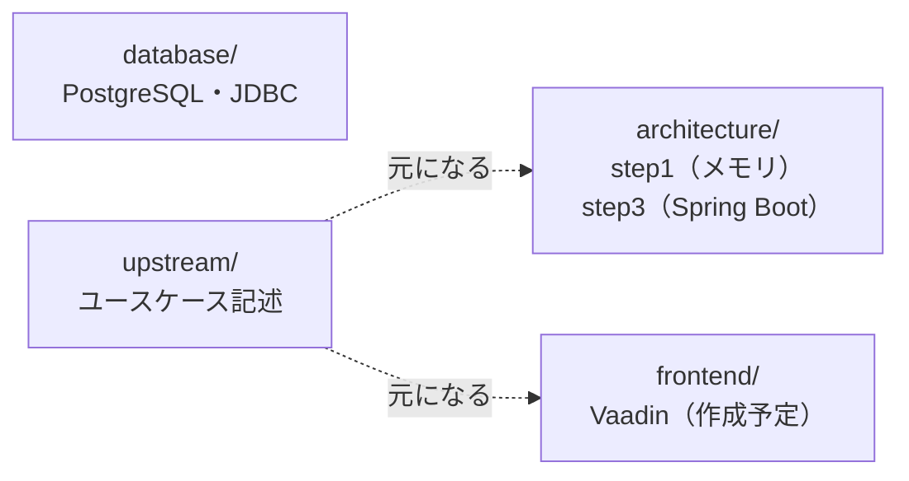

# PRMN_SYSTEM_Sample

公立千歳科学技術大学のプロジェクトメンバー（システム班）向け教育資料 [PRMN_SYSTEM_Lecture](https://github.com/YTS0418/PRMN_SYSTEM_Lecture) の、**サンプルリポジトリ**です。資料に出てくる、動く完成コードを、**資料ごとのフォルダ**にまとめています。

題材は、資料と同じ**成績管理システム**です（学生の登録、成績の登録、成績一覧の表示）。

> [!TIP]
> 資料では考え方（なぜ・何を・どこに）を説明し、このリポジトリでは**どう書くか**を確認します。資料を読みながら、このリポジトリのコードを IDE で開いておくのがおすすめです。

## 目次

資料ごとにフォルダを分けてあり、**各フォルダは、それだけで動かせます**（必要な SQL なども、フォルダの中に入っています）。動かし方は、各フォルダの `README.md` にあります。

| フォルダ | 対応する資料 | 内容 | 動かし方 |
|---|---|---|---|
| [`database/`](database/) | [データベース編](https://github.com/YTS0418/PRMN_SYSTEM_Lecture/blob/main/データベース/00_はじめに.md) | テーブル定義とサンプルデータ（`db/`）、JdbcClient で PostgreSQL に保存する Java（`step2-jdbc/`） | [database/README.md](database/README.md) |
| [`architecture/`](architecture/) | [4層アーキテクチャ編](https://github.com/YTS0418/PRMN_SYSTEM_Lecture/blob/main/4層アーキテクチャ/00_はじめに.md) | 4 層に分けた成績管理。メモリ版（`step1-memory/`）と Spring Boot 版（`step3-spring/`） | [architecture/README.md](architecture/README.md) |
| [`upstream/`](upstream/) | [上流工程](https://github.com/YTS0418/PRMN_SYSTEM_Lecture/blob/main/上流工程/00_はじめに.md) | ユースケース記述と、コードから起こした確認用の文章 | [upstream/ユースケース記述.md](upstream/ユースケース記述.md) |
| [`frontend/`](frontend/) | [フロントエンド編（Vaadin）](https://github.com/YTS0418/PRMN_SYSTEM_Lecture/blob/main/フロントエンド/00_はじめに.md) | Vaadin で作った画面（作成予定） | [frontend/README.md](frontend/README.md) |

> [!NOTE]
> フォルダどうしは、**実行時には依存しません**。同じ成績管理システムを題材にしているため、Java のコードや SQL の一部は、**フォルダごとにコピー**を持っています（独立して動かすためです）。コピーの内容がずれていないかは、[`tools/check-db-copies.sh`](tools/check-db-copies.sh) で確認できます。

### 共通の準備

| 必要なもの | 使うフォルダ | 備考 |
|---|---|---|
| JDK 25 | すべて | `java -version` で確認する（[Java 入門 01 章](https://github.com/YTS0418/PRMN_SYSTEM_Lecture/blob/main/付録/Java入門/01_Javaとは・環境構築.md)） |
| PostgreSQL | `database/`、`architecture/step3-spring/`、`frontend/` | [データベース編 07 章](https://github.com/YTS0418/PRMN_SYSTEM_Lecture/blob/main/データベース/07_PostgreSQL環境構築.md) |
| Maven | `database/step2-jdbc/` | `step3-spring` は同梱の `mvnw` を使うので不要。IDE（IntelliJ IDEA など）で開いてもよい |

## コードの書き方の決まり

このサンプルは、プロメンのガイドライン（ユースケース記述 → モデリング → コード）に沿って書いています。

### 層と資料の呼び名

資料（4層アーキテクチャ編）とは、層の呼び名とパッケージ名が次のように対応します。

| このサンプル（ガイドライン） | パッケージ | 資料での呼び名 | 役割 |
|---|---|---|---|
| プレゼンテーション層 | `grades.presentation` | Presentation 層 | 入力を受け取り、結果を表示する |
| ビジネスロジック層 | `grades.usecase` | Application 層 | ユースケースの手順を、上から順に並べる |
| ドメイン層 | `grades.domain` | Domain 層 | 業務のルール（点数の範囲、合格点、平均点の求め方）と、保存の窓口（インタフェース） |
| データアクセス層 | `grades.dataaccess` | Infrastructure 層 | 保存の窓口を、メモリや PostgreSQL で実装する |

### ユースケース 1 つ = クラス 1 つ

`usecase` パッケージには、ユースケースの名前をそのままクラス名にしたクラスを置きます。どのクラスも、メソッドは `実行する` の 1 つだけです。

| ユースケース（クラス名） | `実行する` がすること |
|---|---|
| `学生を登録する` | 学生を作り、学生リポジトリで保存する |
| `成績を登録する` | 学生と科目がいることを確かめ、履修を作り、履修リポジトリで保存する |
| `成績一覧を取得する` | 学生と履修一覧を探し、成績明細と平均点をまとめて成績一覧を作る |
| `学生一覧を取得する` | 画面で学生を選ぶための一覧を返す |
| `科目一覧を取得する` | 画面で科目を選ぶための一覧を返す |

ユースケース記述と、コードから起こした確認用の文章は、[`upstream/ユースケース記述.md`](upstream/ユースケース記述.md) にあります。

### 日本語プログラミング

クラス名・メソッド名・変数名は、**日本語**で書いています。ユースケース記述に出てくる言葉（学生、履修、点数、保存する など）を、そのままコードの名前にするためです。

| 日本語にするもの | 英語のままにするもの |
|---|---|
| クラス名（`学生`、`成績を登録する`） | パッケージ名（`domain`、`usecase` など。ガイドラインの決まり） |
| メソッド名（`実行する`、`平均点を計算する`） | Java が決めている名前（`Main`、`main`、`String`、`List` など） |
| 変数名・record の項目名（`氏名`、`点数`） | データベースのテーブル名・列名（`students.name` など） |
| | Web API の URL と JSON のキー（`/students`、`"name"` など） |

- 「学生リポジトリ 学生リポジトリ」のように、**型の名前と変数の名前が同じ**になる箇所があります。左が型、右が変数です（英語で `StudentRepository studentRepository` と書くのと同じです）。
- 日本語の名前と、データベースの列名・JSON のキーとの対応は、層の端のクラス（`Jdbc…リポジトリ`、`学生コントローラ`）だけが受け持ちます。

> [!NOTE]
> ファイル名も日本語になります（`学生.java` など）。文字コードは **UTF-8** です。Windows で文字化けやコンパイルエラーが出るときは、エディタと IDE の文字コードが UTF-8 になっているかを確認してください。

## 注意

教育用のサンプルです。データはすべて架空のもので、実在の人物・団体とは関係ありません。
