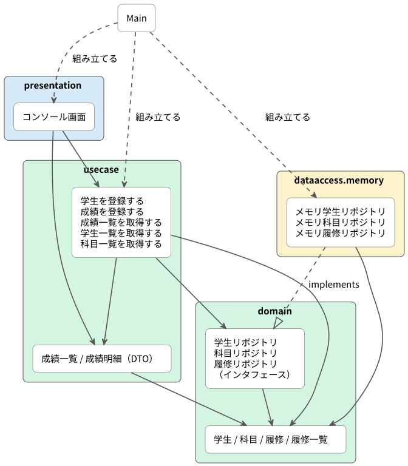
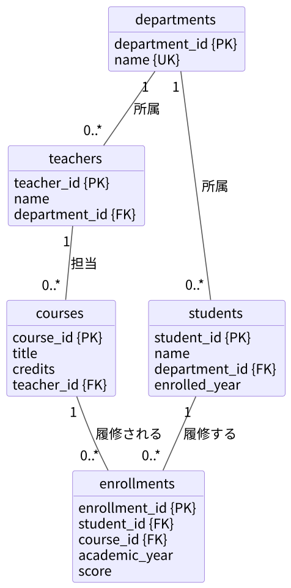
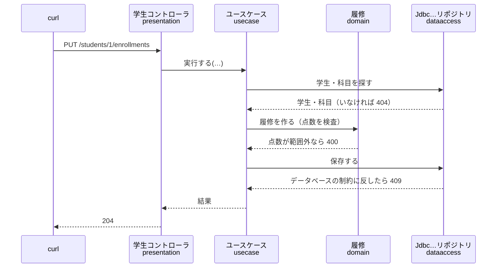
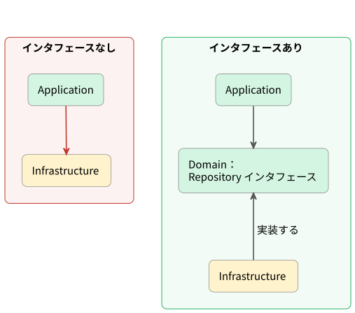

# architecture — 4層アーキテクチャ編のサンプル

[🏠 サンプルの目次](../README.md#目次) ｜ [📖 対応する資料：4層アーキテクチャ編](https://github.com/YTS0418/PRMN_SYSTEM_Lecture/blob/main/4層アーキテクチャ/00_はじめに.md)

資料：[4層アーキテクチャ編](https://github.com/YTS0418/PRMN_SYSTEM_Lecture/blob/main/4層アーキテクチャ/00_はじめに.md)。同じ成績管理システムを、4 層に分けて作った例です。この README だけで、動かせます。

> [!NOTE]
> コード・層の呼び名・日本語の名前の決まりは、[ルートの README](../README.md#コードの書き方の決まり) にあります。

## 構成

| フォルダ | 内容 | 対応する資料 |
|---|---|---|
| [`step1-memory/`](step1-memory/) | 4 層に分けた成績管理。保存先は**メモリ**（コンソールで操作） | 4層編 [04 章](https://github.com/YTS0418/PRMN_SYSTEM_Lecture/blob/main/4層アーキテクチャ/04_Javaで4層を作る.md)・[06 章](https://github.com/YTS0418/PRMN_SYSTEM_Lecture/blob/main/4層アーキテクチャ/06_サンプル実装の読み方.md) |
| [`step3-spring/`](step3-spring/) | **Spring Boot** で書き直したもの（Web API）。保存先は PostgreSQL | 4層編 [07 章](https://github.com/YTS0418/PRMN_SYSTEM_Lecture/blob/main/4層アーキテクチャ/07_Spring_Bootで書き直す.md) |
| [`db/`](db/) | `step3-spring` が使う、テーブル定義とサンプルデータ（SQL） | データベース編 [06](https://github.com/YTS0418/PRMN_SYSTEM_Lecture/blob/main/データベース/06_物理設計.md)〜[11](https://github.com/YTS0418/PRMN_SYSTEM_Lecture/blob/main/データベース/11_トランザクション.md) 章 |

> [!NOTE]
> 保存先を PostgreSQL（JdbcClient）に差し替えた、素の Java 版（step2）は、データベース編のサンプル（[`../database/step2-jdbc/`](../database/step2-jdbc/)）にあります（資料は、[データベース編 12 章](https://github.com/YTS0418/PRMN_SYSTEM_Lecture/blob/main/データベース/12_JavaからDBを使う_JDBC.md)）。

| 層 | パッケージ | step1 | step3 |
|---|---|---|---|
| プレゼンテーション層 | `presentation` | `コンソール画面` | `学生コントローラ`（HTTP） |
| ビジネスロジック層 | `usecase` | `学生を登録する` など 5 クラス | 同じクラス（アノテーションを付けただけ） |
| ドメイン層 | `domain` | `学生`、`履修`、`履修一覧` など | **同じ** |
| データアクセス層 | `dataaccess` | `メモリ…リポジトリ` | `Jdbc…リポジトリ`（`@Repository`） |
| 組み立て | — | `Main` | Spring（DI コンテナ） |



各層の役割と、依存の向き（どの層がどの層を使ってよいか）は、[4層編 02 章](https://github.com/YTS0418/PRMN_SYSTEM_Lecture/blob/main/4層アーキテクチャ/02_4層の役割.md)と[03 章](https://github.com/YTS0418/PRMN_SYSTEM_Lecture/blob/main/4層アーキテクチャ/03_依存の向きとインタフェース.md)で説明しています。

## 準備

| 必要なもの | 使うフォルダ | 備考 |
|---|---|---|
| JDK 25 | すべて | `java -version` で確認する |
| PostgreSQL | `step3-spring` | [データベース編 07 章](https://github.com/YTS0418/PRMN_SYSTEM_Lecture/blob/main/データベース/07_PostgreSQL環境構築.md) |
| Maven | — | `step3-spring` は同梱の `mvnw` を使うので不要 |

`step1-memory` は、PostgreSQL も Maven も要りません。まずは step1 から試してください。

## step1-memory：メモリ版を動かす

```bash
cd step1-memory
java src/grades/Main.java
```

<details>
<summary>コマンドの意味を見る</summary>

| 部分 | 意味 |
|---|---|
| `cd step1-memory` | 作業するフォルダを `step1-memory` に移る（change directory） |
| `java` | Java のプログラムを実行するコマンド |
| `src/grades/Main.java` | 起動するファイル。`.java` を直接渡すと、コンパイルしてからそのまま実行する。`Main` が使っているほかのファイルも、`src` の下から自動で探してくれる |

</details>

メニューから、学生の登録 → 成績の登録 → 成績一覧の表示を試せます。**アプリを終了すると、データは消えます**（保存先がメモリのため）。

点数に `150` を入れると、`エラー: 点数は0〜100にしてください: 150` と表示されます。このエラーはドメイン層（`履修`）が出したものです。

> [!WARNING]
> **Windows のコマンドプロンプトで、入力した日本語（学生の名前など）が文字化けするとき**：先に `chcp 65001` を実行してから `java` を実行してください（コンソールの文字コードを UTF-8 にします）。
> **IntelliJ IDEA で、`Main.java` が読み取り専用（コーヒーのマーク）になって実行できないとき**：`step1-memory` の下の `src` を右クリックして、「ディレクトリをマーク」→「ソース ルート」を選びます。

## データベースを用意する（step3 の前に）



PostgreSQL にデータベース `grades_db` を作り、テーブルとサンプルデータを入れます。**このフォルダ**（`architecture/`）で実行してください。テーブルの作り方と SQL の基本は、[データベース編 08 章](https://github.com/YTS0418/PRMN_SYSTEM_Lecture/blob/main/データベース/08_SQL_DDL.md)・[09 章](https://github.com/YTS0418/PRMN_SYSTEM_Lecture/blob/main/データベース/09_SQL_基本操作.md)にあります。

```bash
psql -U postgres -c "CREATE DATABASE grades_db"
psql -U postgres -d grades_db -f db/01_schema.sql
psql -U postgres -d grades_db -f db/02_seed.sql
```

`psql` は、PostgreSQL に接続して SQL を実行するコマンドです。`-` で始まる部分（オプション）で、「誰として」「どのデータベースに」「何を実行するか」を指定します。

<details>
<summary>コマンドの意味を見る</summary>

| 部分 | 意味 | この例では |
|---|---|---|
| `-U postgres` | 接続する**ユーザー**（User）の名前 | `postgres`（PostgreSQL を入れたときに作られる管理者） |
| `-d grades_db` | 接続する**データベース**（database）の名前 | `grades_db`。省略すると、ユーザー名と同じ名前のデータベースに接続する |
| `-c "SQL 文"` | `"` で囲んだ **SQL 文を 1 つ実行**して終了する（command） | `CREATE DATABASE grades_db`（データベースを作る） |
| `-f ファイル` | **ファイルに書かれた SQL** を上から順に実行して終了する（file） | `db/01_schema.sql`（テーブルを作る）、`db/02_seed.sql`（サンプルデータを入れる） |

</details>

- 1 行目に `-d` がないのは、`grades_db` を**これから作る**ので、まだ接続できないためです。
- `-f` のパスは、今いるフォルダから見た場所です。そのため、このフォルダ（`architecture/`）で実行します。
- 実行すると、ユーザー `postgres` の**パスワード**を聞かれます（PostgreSQL を入れたときに決めたもの）。入力しても画面には表示されません。
- `-c` も `-f` も付けずに `psql -U postgres -d grades_db` とすると、SQL を 1 行ずつ打ち込める画面になります（`\q` で終了）。

> [!WARNING]
> **Windows で `enrollments` や外部キー（`foreign key`）のエラーが出るとき**：`psql` の文字コードが UTF-8 ではないのが原因です。`.sql` ファイルの日本語を読み違えて、一部の `INSERT` が失敗し、そのあとの `INSERT`（`courses` や `enrollments`）も、つながりを失ってエラーになります。先に環境変数 `PGCLIENTENCODING` を `UTF8` にしてから、`01_schema.sql` → `02_seed.sql` の順に流し直してください（コマンドプロンプトは `set PGCLIENTENCODING=UTF8`、PowerShell は `$env:PGCLIENTENCODING = 'UTF8'`）。

> [!WARNING]
> `01_schema.sql` は、学習用に**テーブルを先に全部消してから作り直します**。すでに大事なデータが入っている `grades_db` には流さないでください。やり直したいときも、`01_schema.sql` → `02_seed.sql` の順に流し直せば、最初の状態に戻ります。

### パスワードの渡し方

このフォルダのアプリは、データベースのパスワードを**環境変数 `DB_PASSWORD`** から読みます。パスワードをコードや設定ファイルに書かないためです。起動するターミナルで、先に設定してください（そのターミナルを閉じるまで有効です）。

| 環境 | 設定の仕方 |
|---|---|
| macOS / Linux / Git Bash | `export DB_PASSWORD='あなたのパスワード'` |
| Windows コマンドプロンプト | `set DB_PASSWORD=あなたのパスワード` |
| Windows PowerShell | `$env:DB_PASSWORD = 'あなたのパスワード'` |

> パスワードを `.env` などのファイルに書く場合は、Git に入れないでください（`.gitignore` に `.env` を入れてあります）。

設定していないと、「環境変数 `DB_PASSWORD` が設定されていません」と表示して終了します。Java からデータベースへの接続のしかたは、[データベース編 12 章](https://github.com/YTS0418/PRMN_SYSTEM_Lecture/blob/main/データベース/12_JavaからDBを使う_JDBC.md)にあります。

## step3-spring：Spring Boot 版を動かす

Spring Boot の考え方と、step1 から書き直す手順は、[4層編 05 章](https://github.com/YTS0418/PRMN_SYSTEM_Lecture/blob/main/4層アーキテクチャ/05_フレームワークとSpring.md)と[07 章](https://github.com/YTS0418/PRMN_SYSTEM_Lecture/blob/main/4層アーキテクチャ/07_Spring_Bootで書き直す.md)にあります。

```bash
cd step3-spring
./mvnw spring-boot:run          # Windows のコマンドプロンプトでは  mvnw.cmd spring-boot:run
```

<details>
<summary>コマンドの意味を見る</summary>

| 部分 | 意味 |
|---|---|
| `./mvnw` | このフォルダに同梱している Maven（Maven Wrapper）。Maven を入れていなくても使える。`./` は「今いるフォルダの」という意味 |
| `spring-boot:run` | Spring Boot のアプリケーションをコンパイルして起動する |
| `#` より右 | コメント（実行されない） |

</details>

ログに `Started 成績管理アプリ` と出れば起動成功です。ポート 8080 で待ち受けます（止めるときは `Ctrl+C`）。接続先は `src/main/resources/application.properties` にあります。

### API



`例外ハンドラ` が、ユースケースや Domain が投げた例外を、404・400・409 のステータスに変えます（図の「いなければ 404」などは、その対応です）。

エンドポイントの作り方と、例外をステータスコードに変える仕組みは、[4層編 07 章](https://github.com/YTS0418/PRMN_SYSTEM_Lecture/blob/main/4層アーキテクチャ/07_Spring_Bootで書き直す.md)を見てください。

| 機能 | HTTP | URL | 成功時 |
|---|---|---|---|
| 学生を登録する | `POST` | `/students` | `200`（登録した学生の JSON） |
| 成績を登録する | `PUT` | `/students/{id}/enrollments` | `204`（本文なし） |
| 成績一覧を取得する | `GET` | `/students/{id}/transcript` | `200`（成績一覧の JSON） |

| 状況 | ステータス |
|---|---|
| 学生や科目が存在しない | `404` |
| 入力が業務のルールに合わない（点数が範囲外など） | `400` |
| データベースの制約に反する（存在しない学科の指定など） | `409` |

### 試す（GET）

`GET` はブラウザでも確認できます。

```bash
curl http://localhost:8080/students/1/transcript
```

`curl` は、URL にリクエストを送って、返ってきた内容を表示するコマンドです。オプションを付けなければ `GET` で送ります。

### 試す（POST / PUT）

JSON のクォートの書き方が、環境によって違います。**自分の環境の書き方**を使ってください。

<details>
<summary>コマンドの意味を見る</summary>

| 部分 | 意味 |
|---|---|
| `-X POST` | HTTP メソッドを指定する（`POST`、`PUT` など）。省略すると `GET` |
| `-H "Content-Type: application/json"` | ヘッダー（Header）を付ける。ここでは「本文は JSON です」と伝えている |
| `-d '...'` | 送る本文（data）。ここに JSON を書く |
| 最後の URL | 送り先 |
| 行末の `\` | コマンドが次の行に続く、という印（macOS / Linux / Git Bash） |

</details>

**macOS / Linux / Git Bash**

```bash
curl -X POST -H "Content-Type: application/json" \
     -d '{"name":"Mika","departmentId":3,"enrolledYear":2025}' \
     http://localhost:8080/students

curl -X PUT -H "Content-Type: application/json" \
     -d '{"courseId":1,"academicYear":2025,"score":80}' \
     http://localhost:8080/students/1/enrollments
```

**Windows コマンドプロンプト**（`"` を `\"` にする。1 行で書く）

```bat
curl -X POST -H "Content-Type: application/json" -d "{\"name\":\"Mika\",\"departmentId\":3,\"enrolledYear\":2025}" http://localhost:8080/students

curl -X PUT -H "Content-Type: application/json" -d "{\"courseId\":1,\"academicYear\":2025,\"score\":80}" http://localhost:8080/students/1/enrollments
```

**Windows PowerShell**（`curl` は別のコマンドの別名なので、`Invoke-RestMethod` を使う）

```powershell
Invoke-RestMethod -Method Post -Uri http://localhost:8080/students `
  -ContentType 'application/json' -Body '{"name":"Mika","departmentId":3,"enrolledYear":2025}'

Invoke-RestMethod -Method Put -Uri http://localhost:8080/students/1/enrollments `
  -ContentType 'application/json' -Body '{"courseId":1,"academicYear":2025,"score":80}'
```

> 成績の登録で `score` を省く（書かない）と、「履修中」になります。同じ（学生, 科目, 年度）をもう一度登録すると、点数が**上書き**されます。

### 確かめてみよう

> [!TIP]
> エラーが出るのは失敗ではなく、**守りたいルールが働いている**ということです。`404`・`400`・`409` が、それぞれ**どの層の判断**なのかを、上の図と見比べて考えてみましょう。

- 存在しない学生（`/students/999/transcript`）で `404` が返る
- 範囲外の点数（`150`）で `400` が返り、「点数は0〜100にしてください」と出る（**ドメイン層が出したエラー**）
- 同じ成績をもう一度登録しても、データベースの行は増えず、点数が上書きされる

> [!WARNING]
> このサンプルには**認証・認可がありません**。`/students/1/transcript` の `1` を `2` に変えるだけで、誰でも他人の成績を見られます。学習用のサンプルなので省いてあります。本番のアプリケーションでは、必ず認証・認可を加えてください（[4層編 07 章 8 節](https://github.com/YTS0418/PRMN_SYSTEM_Lecture/blob/main/4層アーキテクチャ/07_Spring_Bootで書き直す.md)）。

## 層の約束を確認する



4 層の「依存の向き」（[4層編 03 章](https://github.com/YTS0418/PRMN_SYSTEM_Lecture/blob/main/4層アーキテクチャ/03_依存の向きとインタフェース.md)）は、`import` 文を見れば確認できます（[4層編 06 章 6 節](https://github.com/YTS0418/PRMN_SYSTEM_Lecture/blob/main/4層アーキテクチャ/06_サンプル実装の読み方.md)）。

```bash
# dataaccess を import しているのは、Main だけのはず
grep -rl "import grades.dataaccess" step1-memory/src

# domain が import しているのは、標準ライブラリ（java.util）だけのはず
grep -h "^import" step1-memory/src/grades/domain/*.java | sort -u
```

<details>
<summary>コマンドの意味を見る</summary>

| 部分 | 意味 |
|---|---|
| `grep "文字列" 場所` | ファイルの中から、その文字列を含む行を探すコマンド |
| `-r` | フォルダの中を、下のフォルダまですべて探す（recursive） |
| `-l` | 見つかった行ではなく、**ファイル名だけ**を表示する。`-rl` は `-r` と `-l` をまとめて書いたもの |
| `-h` | ファイル名を付けずに、見つかった行だけを表示する |
| `"^import"` | `^` は「行の先頭」。`import` で始まる行を探す |
| `*.java` | そのフォルダの、名前が `.java` で終わるファイルすべて |
| `\| sort -u` | 左のコマンドの結果を並べ替えて、同じ行を 1 つにまとめる（`\|` は、結果を次のコマンドに渡す記号） |

</details>

---

[🏠 サンプルの目次](../README.md#目次) ｜ [📖 対応する資料：4層アーキテクチャ編](https://github.com/YTS0418/PRMN_SYSTEM_Lecture/blob/main/4層アーキテクチャ/00_はじめに.md)
