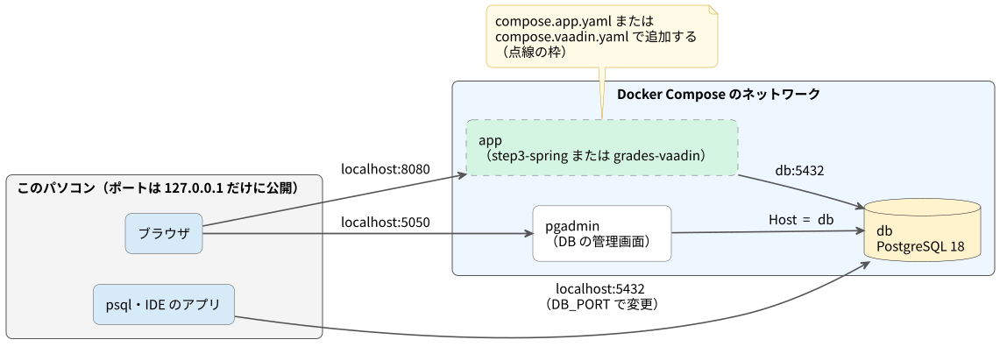
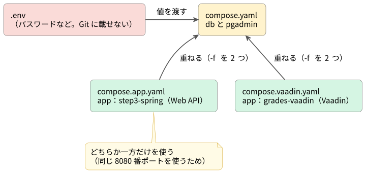
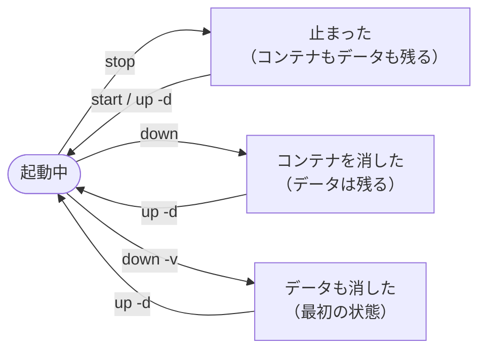

# docker — Docker / Compose 編のサンプル

[🏠 サンプルの目次](../README.md#目次) ｜ [📖 対応する資料：Docker / Compose 編](https://github.com/YTS0418/PRMN_SYSTEM_Lecture/blob/main/Docker/00_はじめに.md)

資料：[Docker / Compose 編](https://github.com/YTS0418/PRMN_SYSTEM_Lecture/blob/main/Docker/00_はじめに.md)。PostgreSQL と pgAdmin、そしてアプリを、Docker Compose で動かす例です。

> [!WARNING]
> **動作確認は、Windows（PowerShell）で行いました**（レビューでの確認）。macOS や Linux では、まだ確かめていません。手順や設定が合わないところがあれば、教えてください。

> [!NOTE]
> このフォルダは、**ほかのフォルダのファイルを参照します**（アプリは `architecture/step3-spring/` や `frontend/grades-vaadin/`、初期データの SQL は `database/db/` や `frontend/db/`）。ほかのフォルダは、そのままにして、このフォルダだけを持ち出しても動きません。

## 構成

| ファイル | 内容 | 対応する資料 |
|---|---|---|
| [`compose.yaml`](compose.yaml) | DB（PostgreSQL 18）と pgAdmin。初回起動で `database/db` の SQL を流す | Docker 編 [04 章](https://github.com/YTS0418/PRMN_SYSTEM_Lecture/blob/main/Docker/04_Docker_Compose入門.md) |
| [`compose.app.yaml`](compose.app.yaml) | アプリ（`step3-spring`）を加える。`compose.yaml` に重ねて使う | Docker 編 [06 章](https://github.com/YTS0418/PRMN_SYSTEM_Lecture/blob/main/Docker/06_アプリとDBをComposeで動かす.md) |
| [`compose.vaadin.yaml`](compose.vaadin.yaml) | アプリを Vaadin 版（`grades-vaadin`）にする。`compose.yaml` に重ねて使う | Docker 編 [05 章 7 節](https://github.com/YTS0418/PRMN_SYSTEM_Lecture/blob/main/Docker/05_Dockerfileとイメージ作成.md) |
| [`.env.example`](.env.example) | パスワードの見本（値は空）。コピーして `.env` を作る | Docker 編 [04 章 6 節](https://github.com/YTS0418/PRMN_SYSTEM_Lecture/blob/main/Docker/04_Docker_Compose入門.md) |
| [`../architecture/step3-spring/Dockerfile`](../architecture/step3-spring/Dockerfile) | `step3-spring` のイメージの作り方（マルチステージ） | Docker 編 [05 章](https://github.com/YTS0418/PRMN_SYSTEM_Lecture/blob/main/Docker/05_Dockerfileとイメージ作成.md) |
| [`../frontend/grades-vaadin/Dockerfile`](../frontend/grades-vaadin/Dockerfile) | `grades-vaadin` のイメージの作り方（`-Pproduction`） | Docker 編 [05 章 7 節](https://github.com/YTS0418/PRMN_SYSTEM_Lecture/blob/main/Docker/05_Dockerfileとイメージ作成.md) |





## 準備

| 必要なもの | 備考 |
|---|---|
| Docker Desktop（または Docker Engine と Compose） | [Docker 編 02 章](https://github.com/YTS0418/PRMN_SYSTEM_Lecture/blob/main/Docker/02_Docker導入.md)。`docker compose version` で確認する |
| インターネット接続 | イメージの取得と、ビルド中のライブラリのダウンロード |

JDK と Maven は、**要りません**（ビルドもコンテナの中で行います）。

以降のコマンドは、**このフォルダ**（`docker/`）で実行してください。

### パスワードを決める

`.env.example` をコピーして `.env` を作り、パスワードを入れます。`.env` は Git に載りません（ルートの `.gitignore`。何を Git に入れて、何を入れないかは、[Docker 編 07 章](https://github.com/YTS0418/PRMN_SYSTEM_Lecture/blob/main/Docker/07_チーム開発での使い方.md)）。

```bash
cp .env.example .env          # Windows の PowerShell では  Copy-Item .env.example .env
```

| 変数 | 内容 |
|---|---|
| `POSTGRES_PASSWORD` | DB の `postgres` ユーザーのパスワード |
| `PGADMIN_PASSWORD` | pgAdmin にログインするパスワード |
| `DB_PORT` | パソコン側の DB のポート番号。空なら `5432`。5432 が使用中なら `5433` など（[よくあるミス](#よくあるミス)） |

> [!CAUTION]
> パスワードは、自分で決めた、推測されにくいものにします。**`.env.example` に、実際の値を書かないでください**。ポートは、すべて `127.0.0.1`（このパソコンだけ）に公開しています。外に公開しないでください（公開するときの考え方は、[Docker 編 08 章](https://github.com/YTS0418/PRMN_SYSTEM_Lecture/blob/main/Docker/08_本番デプロイの考え方.md)）。

## 1. DB と pgAdmin だけ動かす

```bash
docker compose up -d
docker compose ps             # db が healthy になるまで待つ
```

| つなぐもの | 接続先 |
|---|---|
| psql など（このパソコンから） | `localhost:5432`（`DB_PORT` を変えたときは、その番号）、データベース `grades_db`、ユーザー `postgres` |
| pgAdmin（ブラウザ） | <http://localhost:5050>（メールアドレス `admin@example.com`、パスワードは `PGADMIN_PASSWORD`） |

pgAdmin でサーバーを登録するとき、Host name/address は **`db`** にします（`localhost` ではありません。[Docker 編 04 章 5 節](https://github.com/YTS0418/PRMN_SYSTEM_Lecture/blob/main/Docker/04_Docker_Compose入門.md)）。

アプリを IDE で動かすなら、これだけで足ります（接続先は `localhost:5432` のまま。`DB_PORT` を変えたときは、環境変数 `SPRING_DATASOURCE_URL` に `jdbc:postgresql://localhost:5433/grades_db` のように設定します。環境変数 `DB_PASSWORD` に、`POSTGRES_PASSWORD` と同じ値を設定します）。

## 2. アプリも Compose で動かす

アプリと DB をつなぐ仕組み（ネットワークと、起動の順序）は、[Docker 編 06 章](https://github.com/YTS0418/PRMN_SYSTEM_Lecture/blob/main/Docker/06_アプリとDBをComposeで動かす.md)にあります。

### step3-spring（Web API）

```bash
docker compose -f compose.yaml -f compose.app.yaml up -d --build
docker compose -f compose.yaml -f compose.app.yaml logs -f app    # Started GradesApplication と出れば成功（Ctrl+C で抜ける）
curl http://localhost:8080/students/1/transcript
```

`ps`、`logs`、`down` にも、**起動したときと同じ `-f` が必要**です（付けないと `no such service: app` になります）。毎回打つのが面倒なら、`.env` に `COMPOSE_FILE=compose.yaml:compose.app.yaml` と書きます（Windows では区切りが `;` です）。

> [!NOTE]
> **Windows の PowerShell では、`curl.exe` と打ちます**（`curl` は `Invoke-WebRequest` の別名で、日本語が文字化けします）。このアプリに `GET /students` はないので、`/students` だけだと `405` になります。
>
> ```powershell
> curl.exe http://localhost:8080/students/1/transcript
> ```

### grades-vaadin（Vaadin）

```bash
docker compose -f compose.yaml -f compose.vaadin.yaml up -d --build
```

<http://localhost:8080> を開きます。ログインできるユーザーは、[`../frontend/README.md`](../frontend/README.md) にあります。初回のビルドは、時間がかかります。

> [!WARNING]
> **`compose.app.yaml` と `compose.vaadin.yaml` は、一緒に使いません**（同じ 8080 番ポートを使うため）。また、Vaadin 版は、ログイン用の `users` テーブルが要るので、`frontend/db` の SQL を使います。**先にもう一方で起動したことがあるときは、`docker compose down -v` で、データを消してから**切り替えてください（初期データは、初回起動のときだけ入るため）。

## 止める・やり直す



コマンドの意味は、[Docker 編 03 章](https://github.com/YTS0418/PRMN_SYSTEM_Lecture/blob/main/Docker/03_Dockerの基本操作.md)と[04 章](https://github.com/YTS0418/PRMN_SYSTEM_Lecture/blob/main/Docker/04_Docker_Compose入門.md)にあります。

| やりたいこと | コマンド |
|---|---|
| 止める（データは残る） | `docker compose stop` |
| コンテナを消す（データは残る） | `docker compose down`（アプリの重ね合わせを付けたときは、`-f` も同じように付ける） |
| **データも消して、最初から**（初期データを入れ直す） | `docker compose down -v` |
| アプリだけ作り直す | `docker compose -f compose.yaml -f compose.app.yaml up -d --build app` |
| 設定の確認（`.env` の展開結果） | `docker compose config` |

> [!WARNING]
> `down -v` は、DB のデータを**すべて消します**。

> [!TIP]
> 迷ったら、`docker compose down -v` で全部消して、`up -d` からやり直すと、最初の状態に戻ります（学習用のデータなので、安心して試せます）。

## よくあるミス

資料にも、[04 章](https://github.com/YTS0418/PRMN_SYSTEM_Lecture/blob/main/Docker/04_Docker_Compose入門.md)・[06 章](https://github.com/YTS0418/PRMN_SYSTEM_Lecture/blob/main/Docker/06_アプリとDBをComposeで動かす.md)に、つまずきやすい点があります。

| ミス | 原因・対処 |
|---|---|
| `.env に POSTGRES_PASSWORD を設定してください` と出る | `.env` が無い、または値が空。`.env.example` から作って、値を入れる |
| 5432 番ポートが使用中（`port is already allocated`） | このパソコンに入れた PostgreSQL が動いている。停止するか、`.env` に `DB_PORT=5433` と書いて、`docker compose up -d` をやり直す。psql などは `5433` 番に、IDE のアプリは `SPRING_DATASOURCE_URL` で `localhost:5433` につなぐ |
| `no such service: app` | `-f compose.yaml -f compose.app.yaml` を付け忘れた（`ps`・`logs`・`down` にも必要） |
| `環境変数 DB_PASSWORD が設定されていません`（`app` のログ） | 古い `compose.app.yaml` / `compose.vaadin.yaml` を使っている。`DB_PASSWORD: ${POSTGRES_PASSWORD...}` を渡す設定に更新する（アプリは `SPRING_DATASOURCE_PASSWORD` ではなく `DB_PASSWORD` を確認する） |
| `405 Method Not Allowed` | URL が違う。`/students` ではなく `/students/1/transcript` を使う |
| PowerShell で、日本語が文字化けする | `curl` ではなく `curl.exe` を使う |
| 8080 番ポートが使用中 | IDE で動かしたアプリが、まだ動いている。停止する |
| `password authentication failed` | `.env` のパスワードを、DB の**作成後**に変えた。ボリュームは、最初のパスワードで作られているので、`down -v` で作り直す |
| `localhost` のまま接続して失敗する（アプリのログ） | コンテナの中の `localhost` は、そのコンテナ自身。環境変数 `SPRING_DATASOURCE_URL` で、`db` を指しているか確認する |
| SQL を直したのに、反映されない | 初期化は初回だけ。`docker compose down -v` で作り直す |
| `./mvnw: not found`（ビルド中） | `mvnw` の改行コードが CRLF になっている。各アプリの `.gitattributes` で LF に固定しているので、clone し直す |

---

[🏠 サンプルの目次](../README.md#目次) ｜ [📖 対応する資料：Docker / Compose 編](https://github.com/YTS0418/PRMN_SYSTEM_Lecture/blob/main/Docker/00_はじめに.md)
