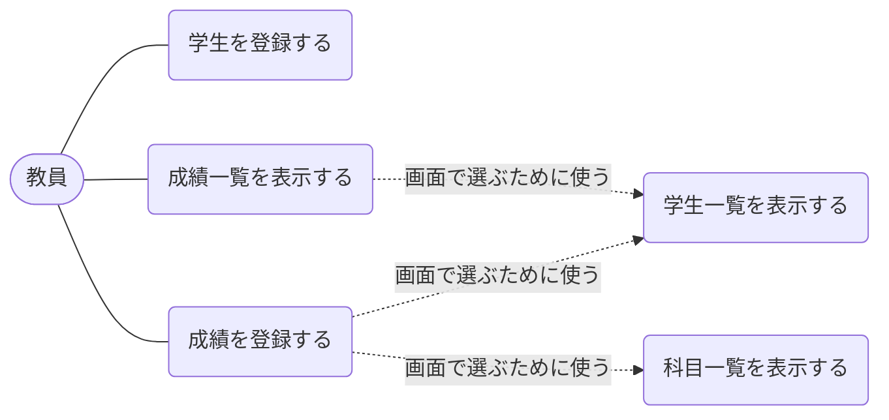
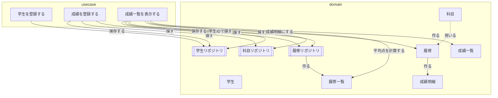

# ユースケース記述と確認用の文章

このサンプルのコードは、プロメンのガイドラインの手順（① ユースケース記述 → ② モデリング → ③ コード → ④ 確認用文章 → ⑤ 見比べて直す）で作っています。このページには、①と④を載せます。

## 読み方

ユースケース記述のメインフローは、次のどれかの形で、1 文ずつ書きます。

| 文の形 | コードでは |
|---|---|
| ーーを用いて ○○ を ×× で〜する | `××` クラスの `〜する(ーー)` メソッド。戻り値が `○○` |
| ーーを用いて ×× で〜する | `××` クラスの `〜する(ーー)` メソッド。戻り値なし |
| ○○ を ×× で〜する | `××` クラスの `〜する()` メソッド。戻り値が `○○` |
| ×× で〜する | `××` クラスの `〜する()` メソッド。戻り値なし |
| ○○ を作る | `new ○○(...)` |

- ○○・××・ーー は、`domain` パッケージのクラスになります。
- ***太字の斜体***の文は、データベースの入出力です。`domain` パッケージの**インタフェース**（`…リポジトリ`）になり、実装は `dataaccess` パッケージに置きます。
- ユースケースの名前は、`usecase` パッケージのクラスになります。メソッドは `実行する` です。

## ユースケース図



## 1. 学生を登録する

### ユースケース記述（メインフロー）

**プレゼンテーション層（ユーザの入出力）**

1. 氏名・学科ID・入学年度を入力する
2. 氏名・学科ID・入学年度を用いて「学生を登録する」で実行する
3. 登録した学生の学生ID と氏名を出力する

**ビジネスロジック層・ドメイン層・データアクセス層（計算・判断・加工・データベースの入出力）**

1. 学生を作る（氏名が空でないか、入学年度が 2000 以上かを判断する）
2. ***学生を用いて学生を学生リポジトリで保存する***

### 確認用の文章（コードから起こしたもの）

```text
1 学生を登録するで実行する
  1.1 学生を作る
  1.2 学生を用いて学生リポジトリで保存する　学生を作る
```

1.2 の「学生を作る」は、採番された学生ID を付けた新しい学生を返していることを表します。

## 2. 成績を登録する

### ユースケース記述（メインフロー）

**プレゼンテーション層**

1. 学生一覧と科目一覧を出力する
2. 学生ID・科目ID・年度・点数を入力する（点数を入力しなければ、履修中）
3. 学生ID・科目ID・年度・点数を用いて「成績を登録する」で実行する
4. 「登録しました」と出力する

**ビジネスロジック層・ドメイン層・データアクセス層**

1. ***学生ID を用いて学生を学生リポジトリで探す***（いなければ、エラーにする）
2. ***科目ID を用いて科目を科目リポジトリで探す***（なければ、エラーにする）
3. 履修を作る（点数が 0〜100 かを判断する）
4. ***履修を用いて履修リポジトリで保存する***（同じ学生・科目・年度があれば、点数を上書きする）

### 確認用の文章

```text
1 成績を登録するで実行する
  1.1 学生リポジトリで探す
  1.2 科目リポジトリで探す
  1.3 履修を作る
  1.4 履修を用いて履修リポジトリで保存する
```

## 3. 成績一覧を表示する

### ユースケース記述（メインフロー）

**プレゼンテーション層**

1. 学生一覧を出力する
2. 学生ID を入力する
3. 学生ID を用いて「成績一覧を表示する」で実行する
4. 成績一覧（氏名、科目ごとの成績明細、平均点）を出力する

**ビジネスロジック層・ドメイン層・データアクセス層**

1. ***学生ID を用いて学生を学生リポジトリで探す***（いなければ、エラーにする）
2. ***学生ID を用いて履修一覧を履修リポジトリで探す***
3. 履修 1 件ごとに、次の 2 つを繰り返す
   1. ***科目ID を用いて科目を科目リポジトリで探す***
   2. 科目と履修を用いて成績明細を作る（合格かどうかは履修で判断する。60 点以上なら合格、履修中は合格ではない）
4. 平均点を履修一覧で計算する（点数のある履修だけで求める。履修中は含めない）
5. 成績一覧を作る

### 確認用の文章

```text
1 成績一覧を表示するで実行する
  1.1 学生リポジトリで探す
  1.2 履修リポジトリで学生IDで探す　履修一覧を作る
  1.3 科目リポジトリで探す
  1.4 科目を用いて履修で成績明細にする　成績明細を作る
    1.4.1 履修で合格している
      1.4.1.1 履修で履修中である
  1.5 履修一覧で平均点を計算する
    1.5.1 履修で履修中である
  1.6 成績一覧を作る
```

1.3 と 1.4 は、履修の件数だけ繰り返します。

## 4. 学生一覧を表示する／科目一覧を表示する

画面で学生や科目を選ぶための、読み取りだけのユースケースです。

**ビジネスロジック層・ドメイン層・データアクセス層**

1. ***学生一覧を学生リポジトリですべて探す***（科目一覧は、***科目リポジトリですべて探す***）

```text
1 学生一覧を表示するで実行する
  1.1 学生リポジトリですべて探す

1 科目一覧を表示するで実行する
  1.1 科目リポジトリですべて探す
```

## モデル

四角がクラス、矢印が「〜する」（矢印の先のクラスのメソッド）です。



`[[ ]]` の四角は、データベースの入出力の窓口（インタフェース）です。
