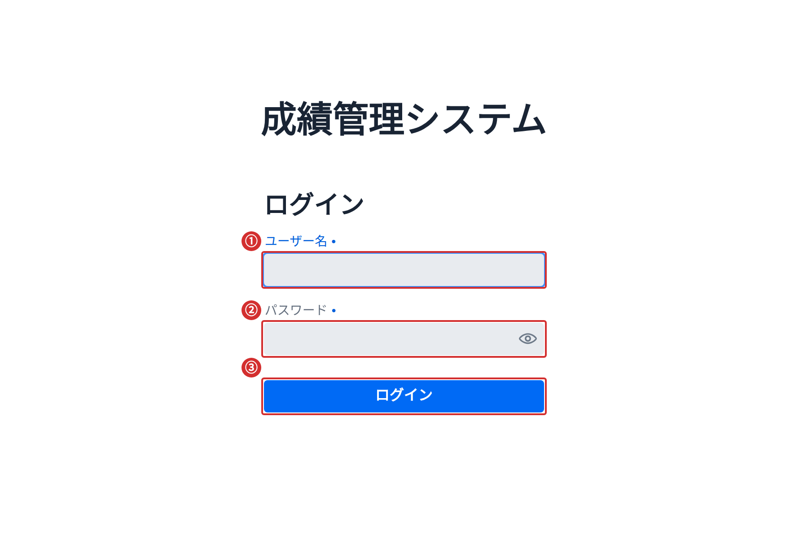
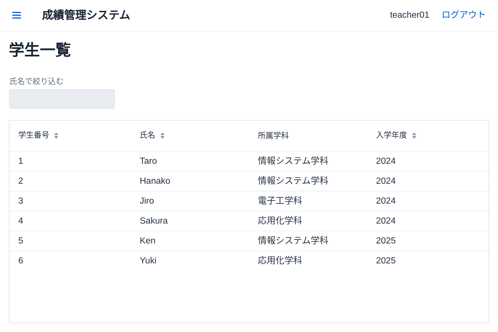
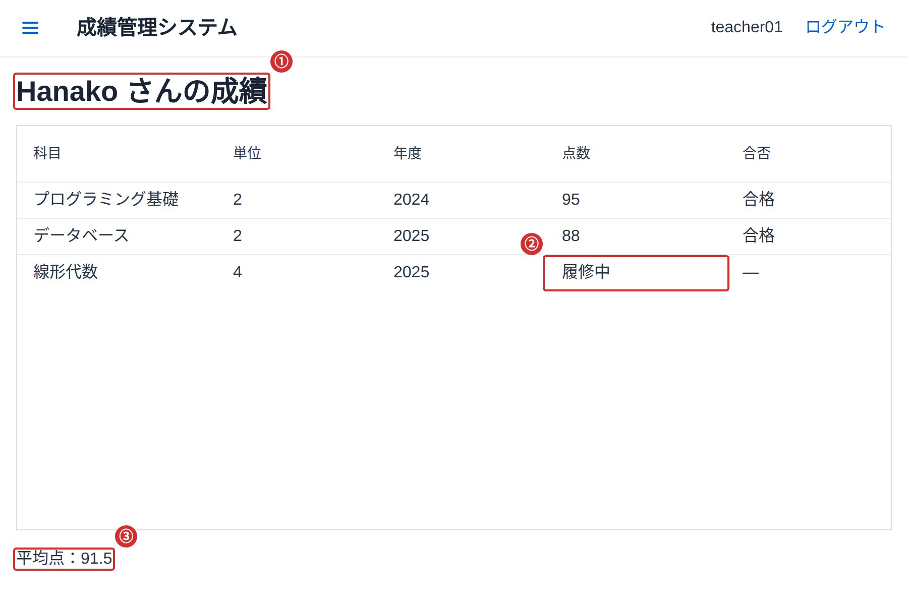
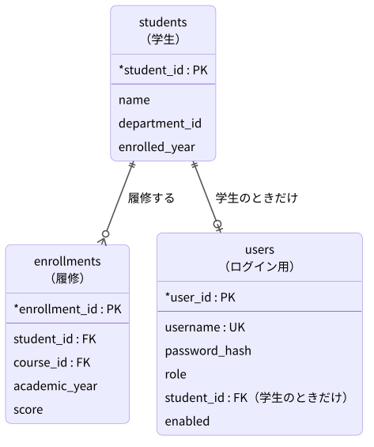
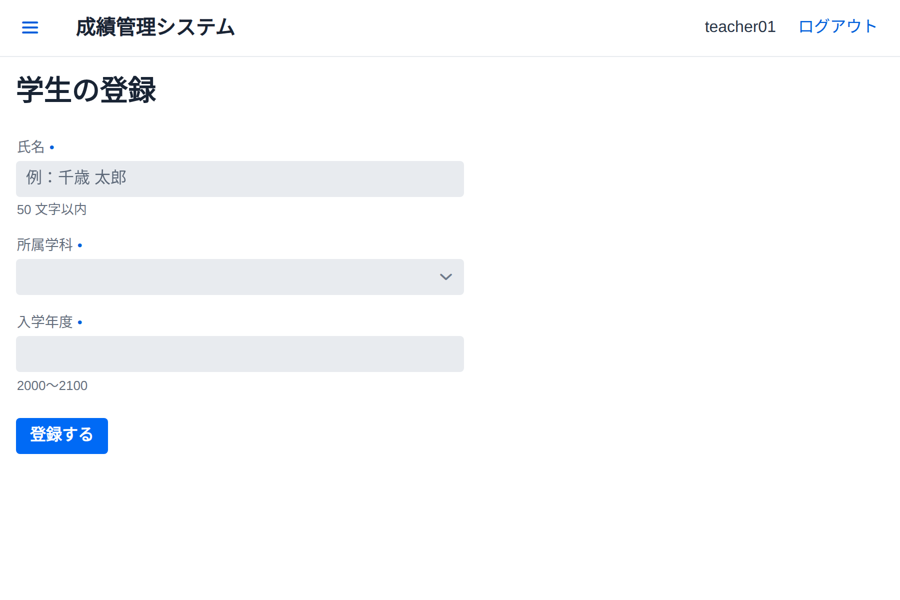
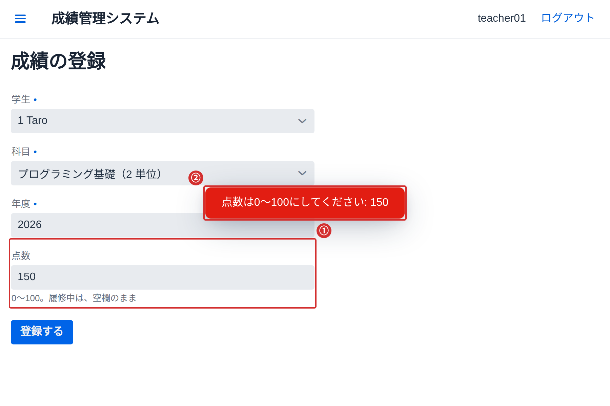
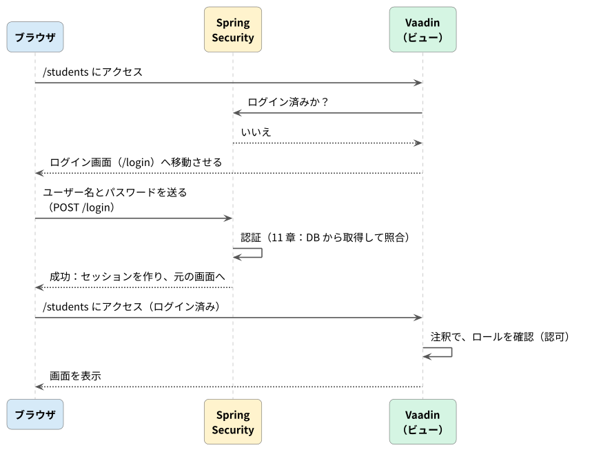
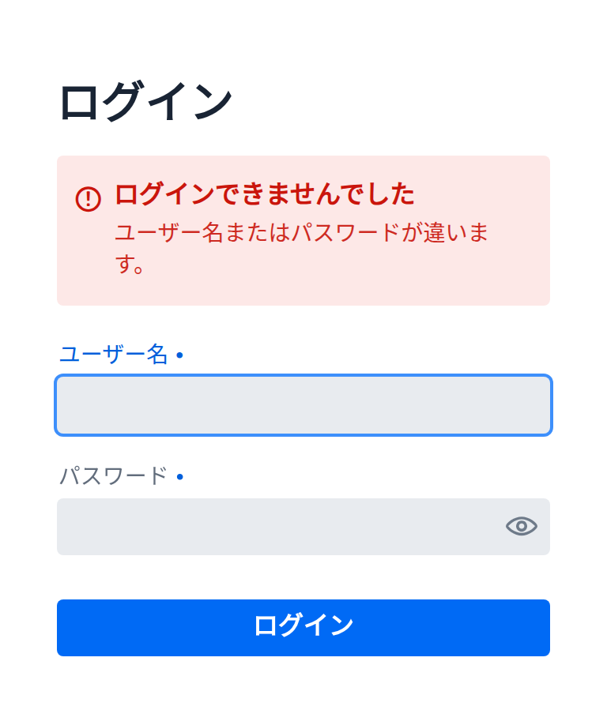

# frontend — フロントエンド編（Vaadin）のサンプル

[🏠 サンプルの目次](../README.md#目次) ｜ [📖 対応する資料：フロントエンド編](https://github.com/YTS0418/PRMN_SYSTEM_Lecture/blob/main/フロントエンド/00_はじめに.md)

資料：[フロントエンド編（Vaadin）](https://github.com/YTS0418/PRMN_SYSTEM_Lecture/blob/main/フロントエンド/00_はじめに.md)。成績管理システムの画面を、**Vaadin 25（LTS）**で作った例です。ログイン（DB 認証・ロール）と、権限のテストを含みます。この README だけで、動かせます。

> [!NOTE]
> コード・層の呼び名・日本語の名前の決まりは、[ルートの README](../README.md#コードの書き方の決まり) にあります。

## 完成すると、こうなります

| ログイン | 学生一覧（教員） | 成績一覧 |
|---|---|---|
|  |  |  |

> [!NOTE]
> 画像の赤枠と番号は、[フロントエンド編](https://github.com/YTS0418/PRMN_SYSTEM_Lecture/blob/main/フロントエンド/00_はじめに.md)の説明に使っている印です（資料と同じ画像を使っています）。

## 構成

| フォルダ | 内容 | 対応する資料 |
|---|---|---|
| [`db/`](db/) | テーブル定義とサンプルデータ。**`users` テーブル**（ログイン用）を含む | [データベース編](https://github.com/YTS0418/PRMN_SYSTEM_Lecture/blob/main/データベース/00_はじめに.md)、フロントエンド編 [11 章](https://github.com/YTS0418/PRMN_SYSTEM_Lecture/blob/main/フロントエンド/11_DB認証とロール.md) |
| [`grades-vaadin/`](grades-vaadin/) | Vaadin（Spring Boot）のアプリ | [フロントエンド編](https://github.com/YTS0418/PRMN_SYSTEM_Lecture/blob/main/フロントエンド/00_はじめに.md) |



### 画面（ビュー）とアクセスできる人

| 画面 | URL | クラス | アクセスできる人 |
|---|---|---|---|
| ログイン | `/login` | `ログインビュー` | 誰でも |
| （トップ） | `/` | `ホームビュー` | ログイン済み。ロールに応じて、最初の画面へ移動する |
| 学生一覧 | `/students` | `学生一覧ビュー` | 教員 |
| 学生の登録 | `/students/register` | `学生登録ビュー` | 教員 |
| 成績の登録 | `/enrollments/register` | `成績登録ビュー` | 教員 |
| 成績一覧 | `/students/{学生番号}/transcript` | `成績一覧ビュー` | 教員、**本人の学生だけ**（ユースケースで確認） |

| 学生の登録（教員） | 成績の登録（点数が範囲外のとき） |
|---|---|
|  |  |

共通の外枠（メニュー、上のバー）は `メインレイアウト` です（[04 章](https://github.com/YTS0418/PRMN_SYSTEM_Lecture/blob/main/フロントエンド/04_レイアウト.md)）。ビューとルーティングは [03 章](https://github.com/YTS0418/PRMN_SYSTEM_Lecture/blob/main/フロントエンド/03_ビューとルーティング.md)、ログインは [10 章](https://github.com/YTS0418/PRMN_SYSTEM_Lecture/blob/main/フロントエンド/10_ログインの基本.md)・[11 章](https://github.com/YTS0418/PRMN_SYSTEM_Lecture/blob/main/フロントエンド/11_DB認証とロール.md)にあります。

資料の画像を撮るための**見本の画面**もあります（教員だけ。メニューには出しません）。資料のコードを、そのまま動かした画面で、見本の `// snippet: 名前` 〜 `// end snippet` の間が、資料に載せているコードと同じものです（Lecture の `check_snippets.py` で、一致を確かめます）。

| URL | 内容（フロントエンド編の章） |
|---|---|
| `/demo/layout` | レイアウト、余白、配置、FormLayout、Tabs、Details（[04 章](https://github.com/YTS0418/PRMN_SYSTEM_Lecture/blob/main/フロントエンド/04_レイアウト.md)） |
| `/demo/input` | TextField の各状態、TextArea、EmailField、NumberField、Checkbox、Select、ComboBox、RadioButtonGroup、CheckboxGroup など（[05 章](https://github.com/YTS0418/PRMN_SYSTEM_Lecture/blob/main/フロントエンド/05_基本コンポーネント.md)） |
| `/demo/button` | ボタンの種類（[05 章](https://github.com/YTS0418/PRMN_SYSTEM_Lecture/blob/main/フロントエンド/05_基本コンポーネント.md)） |
| `/demo/display` | 見出し、段落、アイコン、Avatar、ProgressBar（[05 章](https://github.com/YTS0418/PRMN_SYSTEM_Lecture/blob/main/フロントエンド/05_基本コンポーネント.md)） |
| `/demo/feedback` | Notification の種類、ConfirmDialog、Dialog、ユースケースの例外の表示（[05 章](https://github.com/YTS0418/PRMN_SYSTEM_Lecture/blob/main/フロントエンド/05_基本コンポーネント.md)・[09](https://github.com/YTS0418/PRMN_SYSTEM_Lecture/blob/main/フロントエンド/09_4層とつなぐ.md) 章） |
| `/demo/navigation` | RouterLink、SideNav（[03 章](https://github.com/YTS0418/PRMN_SYSTEM_Lecture/blob/main/フロントエンド/03_ビューとルーティング.md)） |
| `/demo/events` | 値の変更のイベント（[06 章](https://github.com/YTS0418/PRMN_SYSTEM_Lecture/blob/main/フロントエンド/06_イベントと画面の仕組み.md)） |
| `/demo/grid` | Grid の列、並べ替え、部品の列、選択（[07 章](https://github.com/YTS0418/PRMN_SYSTEM_Lecture/blob/main/フロントエンド/07_Gridで一覧を表示する.md)） |
| `/demo/form` | Binder の入力チェックの表示（[08 章](https://github.com/YTS0418/PRMN_SYSTEM_Lecture/blob/main/フロントエンド/08_フォームとBinder.md)） |
| `/demo/login` | LoginForm の文言とエラー（[10 章](https://github.com/YTS0418/PRMN_SYSTEM_Lecture/blob/main/フロントエンド/10_ログインの基本.md)） |
| `/demo/security` | 入力された文字の表示：Span と Html の違い（[12 章](https://github.com/YTS0418/PRMN_SYSTEM_Lecture/blob/main/フロントエンド/12_Webアプリの脅威と対策.md)） |
| `/demo/theme` | CSS のクラス名、変数の上書き、ダークモード（[13 章](https://github.com/YTS0418/PRMN_SYSTEM_Lecture/blob/main/フロントエンド/13_テーマとスタイル.md)） |
| `/demo/advanced` | Upload、Signals（[A4](https://github.com/YTS0418/PRMN_SYSTEM_Lecture/blob/main/フロントエンド/A4_発展的な機能.md)） |

### 層との対応（`grades-vaadin/src/main/java/grades/`）

4 層の考え方は、[4層編 02 章](https://github.com/YTS0418/PRMN_SYSTEM_Lecture/blob/main/4層アーキテクチャ/02_4層の役割.md)と、[フロントエンド編 09 章](https://github.com/YTS0418/PRMN_SYSTEM_Lecture/blob/main/フロントエンド/09_4層とつなぐ.md)にあります。

| 層 | パッケージ | 内容 |
|---|---|---|
| Presentation | `presentation` | ビュー、レイアウト、`セキュリティ設定`、入力フォーム（Binder 用） |
| Application | `usecase` | ユースケース（`@PreAuthorize` で権限を確認）、`ログインユーザー`、`成績の権限` |
| Domain | `domain` | 業務のルール（4層編の `step3-spring` と同じ。学科を足している。[フロントエンド編 09 章](https://github.com/YTS0418/PRMN_SYSTEM_Lecture/blob/main/フロントエンド/09_4層とつなぐ.md)） |
| Infrastructure | `dataaccess.jdbc` | JdbcClient のリポジトリ、`DBユーザー実装`（`users` を読む） |

## 準備

プロジェクトの作り方と、起動までの手順は、[フロントエンド編 02 章](https://github.com/YTS0418/PRMN_SYSTEM_Lecture/blob/main/フロントエンド/02_環境構築とプロジェクト作成.md)にあります。

| 必要なもの | 備考 |
|---|---|
| JDK 25 | `java -version` で確認する |
| PostgreSQL | [データベース編 07 章](https://github.com/YTS0418/PRMN_SYSTEM_Lecture/blob/main/データベース/07_PostgreSQL環境構築.md) |
| Maven | 不要（同梱の `mvnw` を使う） |
| インターネット接続 | 初回の起動で、Vaadin が、画面用の部品をダウンロードする（時間がかかる） |

## データベースを用意する

PostgreSQL にデータベース `grades_db` を作り、テーブルとサンプルデータを入れます。**このフォルダ**（`frontend/`）で実行してください。

```bash
psql -U postgres -c "CREATE DATABASE grades_db"
psql -U postgres -d grades_db -f db/01_schema.sql
psql -U postgres -d grades_db -f db/02_seed.sql
```

`psql` のオプションの意味や、Windows で文字化けするときの対処は、[`architecture/README.md`](../architecture/README.md) の「データベースを用意する」と同じです。

> [!WARNING]
> `01_schema.sql` は、学習用に**テーブルを先に全部消してから作り直します**。大事なデータが入っている `grades_db` には流さないでください。

### パスワードの渡し方

アプリは、データベースのパスワードを**環境変数 `DB_PASSWORD`** から読みます（コードや設定ファイルに書かないため）。起動するターミナルで、先に設定してください。

| 環境 | 設定の仕方 |
|---|---|
| macOS / Linux / Git Bash | `export DB_PASSWORD='あなたのパスワード'` |
| Windows コマンドプロンプト | `set DB_PASSWORD=あなたのパスワード` |
| Windows PowerShell | `$env:DB_PASSWORD = 'あなたのパスワード'` |

接続先を変えるときは、環境変数 `SPRING_DATASOURCE_URL`（例：`jdbc:postgresql://localhost:5432/grades_db`）を設定します。

## 動かす

```bash
cd grades-vaadin
./mvnw spring-boot:run          # Windows のコマンドプロンプトでは  mvnw.cmd spring-boot:run
```

ログに `Started 成績管理アプリ` と出たら、ブラウザで <http://localhost:8080> を開きます（止めるときは `Ctrl+C`）。初回は、画面用の部品の準備に時間がかかります。

### ログインできるユーザー（開発・講義用の仮のもの）

| ユーザー名 | パスワード | ロール | できること |
|---|---|---|---|
| `teacher01` | `grades-sample` | 教員（`TEACHER`） | すべての画面 |
| `student01` | `grades-sample` | 学生（`STUDENT`、学生番号 1） | **自分の成績一覧だけ** |
| `student02` | `grades-sample` | 学生（`STUDENT`、学生番号 2） | **自分の成績一覧だけ** |

`db/02_seed.sql` には、パスワードを **BCrypt でハッシュ化した値**だけを保存しています。ログインの流れは、次の図のとおりです。



> [!CAUTION]
> これは、学習用の**仮のユーザーとパスワード**です。公開するアプリには、絶対に持ち込まないでください（[フロントエンド編 A2](https://github.com/YTS0418/PRMN_SYSTEM_Lecture/blob/main/フロントエンド/A2_本番ビルドとデプロイ.md)）。

### 確かめてみよう（権限）

> [!TIP]
> まず `teacher01` でログインして、学生一覧を見てから、ログアウトして `student01` でログインし直してみましょう。**同じアドレスでも、見られる画面が変わる**ことが分かります。

- `teacher01` で、学生一覧 → 行を選ぶと、成績一覧が見られる
- `student01` でログインして、アドレスを `/students/2/transcript` に変えても、「**この成績は表示できません**」と出る（**ユースケースが拒否**する。[フロントエンド編 12 章](https://github.com/YTS0418/PRMN_SYSTEM_Lecture/blob/main/フロントエンド/12_Webアプリの脅威と対策.md)）
- `student01` で `/students/register` を開くと、**アクセスできない**（ビューの注釈が拒否する）
- 学生を登録するときの入学年度を、1999 にすると、画面の入力チェックが、エラーを表示する
- 成績の登録で、点数に `150` を入れると、**Domain の検査**（`履修`）が、「点数は0〜100にしてください」を通知に出す。この画面は、点数の範囲を、画面では制限していない（業務のルールの本体は Domain。フロントエンド編 [08](https://github.com/YTS0418/PRMN_SYSTEM_Lecture/blob/main/フロントエンド/08_フォームとBinder.md)・[09 章](https://github.com/YTS0418/PRMN_SYSTEM_Lecture/blob/main/フロントエンド/09_4層とつなぐ.md)）
- 間違ったパスワードでは、「ユーザー名またはパスワードが違います」と出る（どちらが違うかは、教えない）

| 権限のない画面を開いたとき | ログインに失敗したとき |
|---|---|
|  |  |

## テスト

```bash
cd grades-vaadin
./mvnw test
```

`権限のテスト` が動きます。データベースも、ブラウザも使わずに、**ユースケースの権限**（学生が他の学生の成績を見られないこと、など）を確かめます（[フロントエンド編 A1](https://github.com/YTS0418/PRMN_SYSTEM_Lecture/blob/main/フロントエンド/A1_画面のテスト.md)）。

> [!NOTE]
> テストのクラス名は、日本語の「〜テスト」です。Maven の既定では見つからないので、`pom.xml` で、`**/*テスト.java` を対象に指定しています。

## 本番用にビルドする（確認用）

```bash
cd grades-vaadin
./mvnw -Pproduction clean package -DskipTests
java -jar target/grades-vaadin-0.0.1-SNAPSHOT.jar
```

`-Pproduction` を付けると、開発用の部品（`vaadin-dev`）が jar に入らず、起動のログに `Vaadin is running in production mode` と出ます（[フロントエンド編 A2](https://github.com/YTS0418/PRMN_SYSTEM_Lecture/blob/main/フロントエンド/A2_本番ビルドとデプロイ.md)。Docker で動かすときは、[Docker 編 05 章](https://github.com/YTS0418/PRMN_SYSTEM_Lecture/blob/main/Docker/05_Dockerfileとイメージ作成.md)）。

## `pom.xml` の要点

| 設定 | 内容 |
|---|---|
| `vaadin-bom` | Vaadin の部品のバージョンを、まとめて管理する（`vaadin.version` = 25.3.5） |
| `vaadin-spring-boot-starter` | Vaadin と Spring Boot をつなぐ |
| `spring-boot-starter-security` | ログイン・ロール |
| `dev` profile（`vaadin-dev`） | **開発モードで必要**。`-Pproduction` を付けると、無効になる |
| `production` profile | 画面用のファイルを最適化する（`build-frontend`） |
| `@StyleSheet(Lumo.STYLESHEET)`（起動クラス） | テーマの指定。**指定しないと、`Notification` の種類などの色が反映されない**（[フロントエンド編 13 章](https://github.com/YTS0418/PRMN_SYSTEM_Lecture/blob/main/フロントエンド/13_テーマとスタイル.md)） |

> [!WARNING]
> **このサンプルには、パスワードの再設定、ログイン失敗の回数制限、二要素認証がありません。** 学習用です。公開する場合は、[フロントエンド編 12 章](https://github.com/YTS0418/PRMN_SYSTEM_Lecture/blob/main/フロントエンド/12_Webアプリの脅威と対策.md)のチェックリストと、[A3](https://github.com/YTS0418/PRMN_SYSTEM_Lecture/blob/main/フロントエンド/A3_発展的な認証.md)を確認してください。

---

[🏠 サンプルの目次](../README.md#目次) ｜ [📖 対応する資料：フロントエンド編](https://github.com/YTS0418/PRMN_SYSTEM_Lecture/blob/main/フロントエンド/00_はじめに.md)
